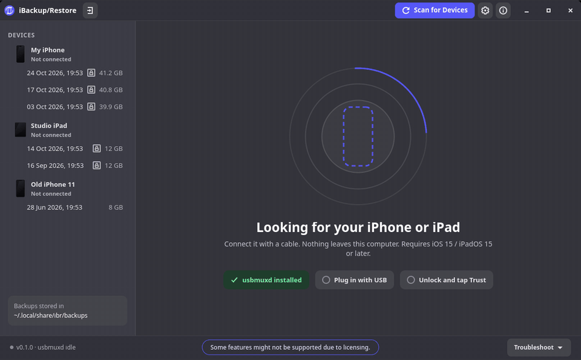

# iBackup/Restore (iBR)



**iBackup/Restore** is the **XeroLinux** app for backing up and restoring iPhone and iPad on Linux, built with Python and GTK4. It makes full or encrypted backups with real progress from the device, keeps the last few backups per device, restores any compatible one, browses photos and app documents with drag and drop, updates or restores iOS from an `.ipsw` you download, and detects devices stuck in Recovery or DFU mode. Supports iPhone and iPad with iOS/iPadOS 15 and newer. Some features might not be supported due to licensing.

## Install

Download the latest `iBR-<version>-x86_64.AppImage` (or `-aarch64`) from [Releases](https://github.com/xerolinux/xero-ibr/releases/latest), then:

```sh
chmod +x iBR-*.AppImage
./iBR-*.AppImage
```

The AppImage bundles everything else (Python, GTK4 and all libimobiledevice tools) and updates itself: an **Update** button appears next to **Scan for Devices** when a new release is out.

On Arch you can also build the package from this repo with `makepkg -si`.

## Required on your system

One thing cannot live inside an AppImage: **usbmuxd**, the system service that talks to iPhone and iPad over USB. It runs as root and ships udev rules, so it has to come from your distribution. iBR tells you if it is missing.

| Distribution | Command |
| --- | --- |
| Arch, CachyOS, EndeavourOS, XeroLinux | `sudo pacman -S usbmuxd` |
| Debian, Ubuntu, Mint, Pop!_OS | `sudo apt install usbmuxd` |
| Fedora, RHEL, Nobara | `sudo dnf install usbmuxd` |
| openSUSE | `sudo zypper install usbmuxd` |
| Void | `sudo xbps-install usbmuxd` |
| Alpine | `sudo apk add usbmuxd` |
| Gentoo | `sudo emerge app-pda/usbmuxd` |
| NixOS | add `services.usbmuxd.enable = true;` to your configuration |

On systemd distributions usbmuxd starts by itself when a device is plugged in. On others, enable the usbmuxd service with your init system.

Optional:

- **Remembering backup passwords** needs a Secret Service keyring (GNOME Keyring or KWallet). Most desktops already run one.
- **Recovery and DFU mode** need USB access the first time. iBR asks for your password once and installs a narrow udev rule for you.

## License

MIT, see [LICENSE](LICENSE).

---

Built on [libimobiledevice](https://libimobiledevice.org). Not affiliated with Apple Inc.
